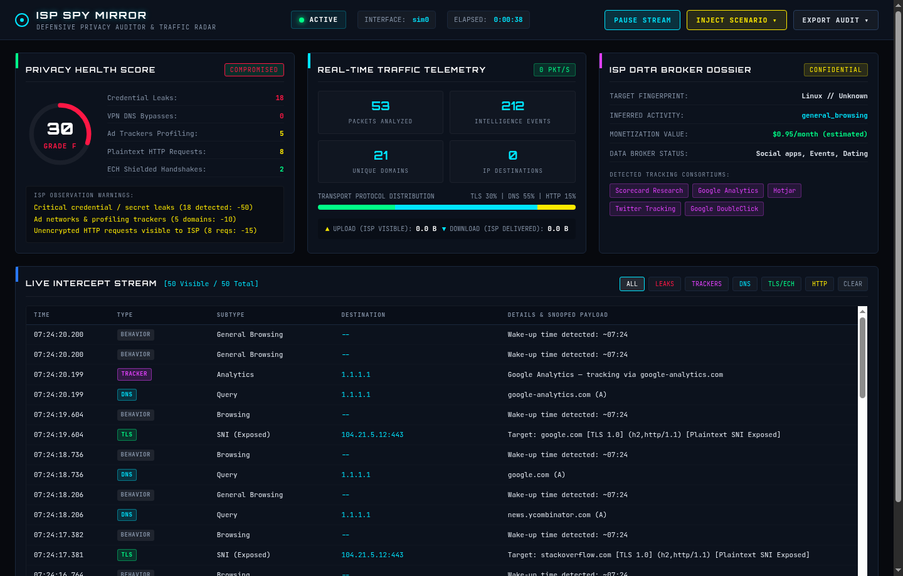
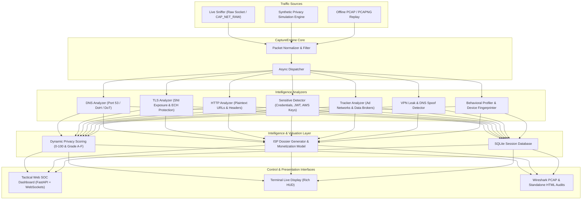

# ISP Spy Mirror

**Defensive Network Privacy Intelligence Suite, Real-Time Traffic Mirror, and ISP Telemetry Radar**

Author: **Abduallah Al Raju**  
Repository: [https://github.com/Abdullah-Al-Raju/isp-spy-mirror](https://github.com/Abdullah-Al-Raju/isp-spy-mirror)  
License: MIT  

---

<!-- SEO:META_START -->
**Keywords:** network-security, packet-sniffer, privacy-audit, isp-surveillance, dns-leak-detection, encrypted-client-hello, ech-detection, sni-inspector, data-broker-profiling, behavioral-profiling, traffic-analysis, scapy, cybersecurity-soc, tactical-web-dashboard, websockets, fastapi, rootless-pcap-replay, privacy-health-score
<!-- SEO:META_END -->

---

## Overview

ISP Spy Mirror is an enterprise-grade defensive network privacy auditor and telemetry monitoring system. It intercepts and parses network packets in real time to reveal exactly what Internet Service Providers (ISPs), local network eavesdroppers, and upstream telecommunications carriers can observe about your browsing habits, application usage, and sensitive data.

The system calculates an algorithmic **Privacy Health Score (0-100)**, generates realistic **ISP Data Broker Dossiers** estimating the market auction value of your subscriber profile, detects unencrypted credentials and API keys in transit, identifies ad network tracking consortiums, audits TLS Server Name Indication (SNI) exposure vs. Encrypted Client Hello (ECH) protection, and exposes DNS queries escaping VPN tunnels.

ISP Spy Mirror features both a rootless synthetic privacy simulation mode and a full real-time interactive **Cyber SOC Web Dashboard & Control Center** powered by FastAPI and WebSockets.



---

## Architectural Workflow



---

## Key Features

### 1. Interactive Tactical Web Control Center
- High-speed WebSocket telemetry streaming updates at sub-second intervals.
- Live Privacy Health Dial with color-coded circular grade gauge (A+, A, B, C, D, F).
- Real-time packet throughput meter, bandwidth upload/download tracking, and protocol distribution bar.
- Interactive stream filter tabs: Leaks, Trackers, DNS, TLS/ECH, and HTTP.
- Control deck allowing live capture pause, resume, and real-time test scenario injection.
- One-click exports for Wireshark PCAPs, interactive HTML audit reports, and raw JSON dossiers.

### 2. Encrypted Client Hello (ECH) & TLS 1.3 Inspection
- Differentiates between TLS handshakes with plain Server Name Indication (SNI) exposed in cleartext and connections protected by Encrypted Client Hello (ECH / draft extension types `0xfe0d`, `0xfe08`, `0xfe09`, `0xfe07`).
- Extracts Application-Layer Protocol Negotiation (ALPN) tokens (`h2`, `http/1.1`, `h3`).
- Tracks subscriber ECH adoption rate and applies privacy score penalties for unshielded SNI leakage.

### 3. Cloud Credential & Deep Secret Leak Detection
- Scans raw packet payloads and unencrypted HTTP requests for sensitive data leakage.
- JSON Web Tokens (`eyJ...` with header and payload decoding).
- AWS Access Key IDs (`AKIA...`, `ASIA...`, `ABIA...`).
- GitHub Personal Access Tokens (`ghp_...`).
- Slack incoming webhook URLs and private cryptographic keys (`-----BEGIN RSA/EC PRIVATE KEY-----`).
- Cleartext HTTP basic auth, bearer tokens, plaintext usernames, passwords, session cookies, and sensitive query parameters.

### 4. VPN Leak & DNS Spoofing Protection
- Real-time detection of DNS queries escaping active VPN tunnels (e.g., `tun0`, `wg0`, `proton0`, `nordlynx`).
- Flags unencrypted queries routed to public recursive resolvers (`8.8.8.8`, `208.67.222.222`).
- Identifies DNS reply tampering and cache poisoning anomalies.

### 5. Tracker Consortium & Behavioral Profiler
- Matches visited hosts against an ad network and tracking database covering Google Analytics, Meta Pixel, DoubleClick, Criteo, AppLovin, Taboola, and Oracle BlueKai.
- Generates an automated ISP Data Broker Dossier classifying subscriber habits (software development, streaming, e-commerce, late-night browsing) and estimating data broker auction CPM values.

### 6. Zero-Root Simulation & PCAP Replay
- Fully functional without root privileges or elevated raw socket capabilities via the built-in synthetic traffic generator.
- Replays recorded `.pcap` and `.pcapng` packet capture dumps for offline privacy auditing.

---

## Installation

### Prerequisites
- Python 3.9, 3.10, 3.11, or 3.12
- Linux / macOS / BSD
- Root or `CAP_NET_RAW` privileges (only required for physical interface live capture; not required for Web simulation or PCAP replay)

```bash
# Clone the repository
git clone https://github.com/Abdullah-Al-Raju/isp-spy-mirror.git
cd isp-spy-mirror

# Create and activate a virtual environment
python3 -m venv venv
source venv/bin/activate

# Install dependencies and project in editable mode
pip install -e .
```

---

## Command Line Interface

ISP Spy Mirror provides a unified CLI dispatcher supporting multiple operational modes:

### 1. Launch Interactive Web Dashboard (Recommended)
```bash
# Launch web dashboard in rootless simulation mode (default)
python main.py web --port 8080

# Launch web dashboard with live network interface capture (requires root)
sudo python main.py web --interface eth0 --port 8080
```
Open `http://127.0.0.1:8080` in your web browser.

### 2. Live Terminal Interface Capture
```bash
# Monitor default network interface until Ctrl+C
sudo python main.py live

# Monitor specific wireless interface for 60 seconds
sudo python main.py live -i wlan0 -d 60
```

### 3. Rootless Synthetic Demo Mode
```bash
# Run terminal live HUD using synthetic traffic generator (no root needed)
python main.py demo -d 30
```

### 4. Offline PCAP Replay Mode
```bash
# Replay and audit a previously captured Wireshark dump
python main.py replay -p /path/to/capture.pcap
```

### 5. Generate Aggregate ISP Dossier
```bash
# Compile cross-session intelligence report from SQLite database
python main.py dossier --db isp_spy.db
```

---

## REST API Reference

When the web dashboard is running, the following REST endpoints are available:

| Method | Endpoint | Description |
|---|---|---|
| `GET` | `/` | Serves the tactical SOC web user interface. |
| `GET` | `/api/status` | Returns system status, elapsed time, and real-time privacy telemetry. |
| `GET` | `/api/stats` | Full multi-analyzer metrics payload across DNS, TLS, HTTP, and trackers. |
| `GET` | `/api/dossier` | Structured ISP Data Broker dossier JSON object. |
| `GET` | `/api/events?limit=100` | Retrieves the most recent intercepted network events. |
| `POST` | `/api/control/pause` | Pauses packet processing and stream updates. |
| `POST` | `/api/control/resume` | Resumes packet processing and stream updates. |
| `POST` | `/api/control/inject` | Injects synthetic privacy test scenarios (`credential_leak`, `jwt_leak`, `aws_leak`, `vpn_leak`, `tracker_storm`, `ech_handshake`). |
| `GET` | `/api/export/pcap` | Downloads recorded session packets as a `.pcap` capture file. |
| `GET` | `/api/export/html` | Generates and downloads a standalone interactive HTML audit report. |
| `GET` | `/api/export/json` | Exports complete session statistics and dossier data. |
| `WS` | `/ws` | WebSocket endpoint streaming live events and telemetry updates. |

---

## Testing & Quality Assurance

ISP Spy Mirror contains an automated unit and integration test suite covering analyzers, synthetic generation, database transactions, and FastAPI endpoints:

```bash
# Execute test suite
pytest -v tests/
```

Test coverage includes:
- DNS query and response structure verification.
- TLS 1.3 ClientHello parsing with plain SNI vs. ECH detection.
- Sensitive data scanning for plaintext passwords, session cookies, JWTs, and AWS access keys.
- Ad network and data broker taxonomy matching.
- VPN tunnel leakage detection.
- Dynamic Privacy Health Score calculations and risk deductions.
- SQLite cross-session queries and report exports.
- FastAPI REST endpoints and scenario injection handlers.

---

## Repository Structure

```
isp-spy-mirror/
├── analyzers/                  # Protocol analyzers and intelligence extractors
│   ├── behavior_analyzer.py    # Habit inference, schedule detection, profiling
│   ├── dns_analyzer.py         # Port 53 query/response parser, DoH/DoT tracking
│   ├── dns_spoof_detector.py   # Cache poisoning and DNS response tampering check
│   ├── fingerprint_analyzer.py # OS, browser, device, and JA3 client identification
│   ├── http_analyzer.py        # Plaintext URL, path, header, and cookie parser
│   ├── metadata_analyzer.py    # IP connection and bandwidth tracking
│   ├── sensitive_detector.py   # Credential, JWT, AWS key, and secret leak scanner
│   ├── tls_analyzer.py         # SNI extraction, ECH detection, ALPN parser
│   ├── tracker_analyzer.py     # Ad network and data broker detection
│   └── vpn_leak_detector.py    # Tunnel bypass and public DNS leak detector
├── assets/                     # Graphical assets and screenshots
│   └── web-dashboard.png       # Headless Chromium verified dashboard screenshot
├── dashboard/                  # Terminal HUD interface
│   └── live_display.py         # Rich-based console dashboard
├── data/                       # Database persistence
│   └── database.py             # SQLite session, domain, connection, and leak tables
├── logger/                     # Session file loggers
│   └── session_logger.py       # Plaintext and JSON stream logging
├── reports/                    # Intelligence report generators
│   ├── dossier.py              # ISP subscriber data broker dossier generator
│   ├── html_report.py          # Standalone responsive HTML audit report builder
│   └── pcap_export.py          # Wireshark-compatible PCAP exporter
├── resolvers/                  # Network and location resolution
│   ├── geo_resolver.py         # Autonomous IP geolocation caching resolver
│   └── hostname_resolver.py    # Reverse DNS resolver
├── simulation/                 # Synthetic traffic generation
│   └── traffic_generator.py    # Scapy-based rootless privacy simulation engine
├── tests/                      # Automated test suite
│   └── test_isp_spy.py         # Unit and integration tests
├── utils/                      # Shared helper utilities
│   └── helpers.py              # Interface detection, IP classifiers, root check
├── web/                        # Web dashboard frontend assets
│   ├── app.js                  # WebSocket client and UI controller
│   ├── index.html              # Tactical SOC HUD HTML structure
│   └── style.css               # Cyberpunk SOC dark stylesheet
├── .github/workflows/ci.yml    # Continuous integration matrix workflow
├── capture.py                  # Core packet capture and analysis pipeline
├── main.py                     # Unified CLI entry point
├── pyproject.toml              # Build system, metadata, and dependencies
└── requirements.txt            # Python package requirements
```

---

## Privacy Scoring Methodology

The Privacy Health Score is calculated on a 0 to 100 scale:

$$\text{Privacy Score} = 100 - \sum \text{Penalties} + \text{Bonuses}$$

| Factor | Deduction | Severity |
|---|---|---|
| Critical Credential / Secret Leak | -20 per leak (max -50) | Critical |
| VPN Tunnel DNS Bypass | -15 per leak (max -30) | High |
| DNS Spoofing / Tampering | -25 flat | Critical |
| Ad Network & Tracker Profiling | -2 per unique tracker domain (max -20) | Medium |
| Plaintext HTTP Requests | -2 per request (max -15) | Medium |
| TLS SNI Exposed without ECH | -10 flat | Moderate |
| Encrypted Client Hello (ECH) Active | +5 bonus | Protected |

### Grading Scale
- **90 - 100:** Grade A+ (Excellent / Fully Shielded)
- **80 - 89:** Grade A (Good / Minor Exposure)
- **70 - 79:** Grade B (Moderate / Noticeable Metadata Leakage)
- **55 - 69:** Grade C (Poor / Multiple Cleartext Indicators)
- **40 - 54:** Grade D (Critical / Cleartext Credentials or Trackers Active)
- **0 - 39:** Grade F (Compromised / Severe Privacy Breach)

---

## Author & Attribution

- **Architect & Developer:** Abduallah Al Raju
- **Project:** ISP Spy Mirror v2.0 Full Intelligence Edition
- **GitHub:** [https://github.com/Abdullah-Al-Raju](https://github.com/Abdullah-Al-Raju)
- **License:** MIT License
